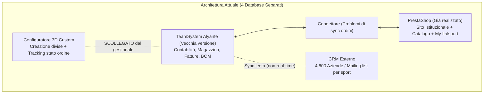

# Analisi Integrale Incontro Cliente: ITALSPORT (`00:00 – 01:13:51`)

> [!IMPORTANT]
> **Sintesi Esecutiva — Cosa vuole davvero il cliente adesso:**
> 1. **Nell'immediato (entro inizio settimana prossima via mail):** Un **Piano Comunicazione & Social ("Storyboard / Indice")** strutturato da fine ottobre al **31 dicembre** (1-3 post al mese ma con un filo conduttore/storia, non post scollegati), una **bozza grafica della pagina Instagram** (incluso un video/reel che valorizzi il **Configuratore 3D** e la produzione custom) e un **preventivo chiaro con costi e impegno orario**. Vuole partire da qui per *"cominciare a conoscerci"*.
> 2. **Sul fronte Sito Web + Gestionale (Il vero "dolore" aziendale):** Il cliente **NON** cerca un semplice rifacimento vetrina e **NON** è convinto che Shopify da solo possa fare da ERP. È bloccato tra un preventivo altissimo (**25.000 – 35.000 €**, con ore fatturate a **60 €/h** gonfiate fino a **300 €** a intervento) per migrare a **Odoo** e l'ipotesi di tamponare il vecchio **TeamSystem (Alyante)** con **3.000 – 4.000 €** entro la **scadenza fiscale di gennaio**. Ha chiesto a voi (salvati in rubrica come **"Fede Studio..."**) di operare come **agenzia esterna** e presentargli una proposta/studio tecnico-economico solo dopo aver verificato che la soluzione copra **tutti** i suoi requisiti fiscali e produttivi.
> 3. **Rapporto di lavoro / Collaborazione futura:** È pronto a inserire **Martina in apprendistato** (appena definito il gestionale) e ha persino aperto alla possibilità futura di farvi entrare con **quote societarie (2% – 3%)** per portare avanti l'azienda.

---

## 1. Identikit del Cliente, Numeri Chiave e Stack Attuale

### Chi sono gli interlocutori nell'audio
* **Titolare di Italsport (Cliente):** Imprenditore con **30 anni di storicità** nel settore dell'abbigliamento sportivo personalizzato e forniture per società sportive. Molto preparato sui processi ERP/contabili/produttivi, prudente sui costi ma umanamente molto aperto verso i giovani.
* **Salvatore (Consulente Tecnico/Informatico):** 21 anni (classe 2005), diplomato all'ITIS Marconi, studente di Ingegneria Informatica al Politecnico di Milano, residente a Cesano.
* **Martina (Consulente Digital, Grafica & Social):** Conosceva già il titolare da un incontro precedente (si danno del *"tu"*); si occupa di grafica, social media, pianificazione e impostazione e-commerce.

### Tutti i Numeri e i Dati di Italsport emersi nell'audio
| Voce / Parametro | Dato Esatto Emerso nell'Audio | Contesto / Note |
| :--- | :--- | :--- |
| **Storicità aziendale** | **30 anni** | Codifica articoli storica strutturata in famiglie, sottofamiglie, gruppi, sottogruppi e marche |
| **Aziende nel CRM** | **4.600 aziende** | Categorizzate per settore: società sportive, oratori, danza, rugby, basket, nuoto, calcio, atletica |
| **Articoli attivi a magazzino** | **2.600 articoli** | Filtrati tra articoli *"in uso"* e *"in esaurimento"* |
| **Archivio totale articoli** | **8.650 articoli** | Inclusi i circa 6.050 articoli *"dismessi / morti"* storicizzati |
| **Volumetria varianti (SKU)** | **100.000 – 200.000 SKU** (~1 milione di pezzi) | Calcolando la matrice modello × colori × taglie (es. 1 articolo × 5 colori × 10 taglie = 50 referenze) |
| **Valore immobilizzo scorte** | **80.000 – 100.000 € per singolo modello** | Esempio del cliente: 50 referenze × 300 pezzi = 15.000 capi × 5-8 € di costo = 80-100k € |
| **Costo fornitore IT attuale (Odoo/Web)** | **25.000 – 35.000 €** | Tariffa oraria di **60 €/ora** (spesso fatturate 5 ore anziché 1 = **300 €** senza capitolato chiuso) |
| **Costo sblocco TeamSystem (Piano B)** | **3.000 – 4.000 €** | Per tamponare il vecchio gestionale ed essere in regola con le **fatture elettroniche a gennaio** |
| **Costo 2 dipendenti a regime** | **40.000 – 50.000 €/anno** | Stima del titolare (finito il periodo agevolato di apprendistato) |
| **Quote societarie ipotizzate** | **2% – 3%** | Apertura del titolare per fidelizzare e responsabilizzare giovani collaboratori nel medio-lungo periodo |

### Architettura Software Attuale (e perché il cliente vuole cambiarla)

---

## 2. Tutte le Richieste del Cliente (Esplicite e Implicite)

### A. Richieste sull'ERP / Gestionale (I "Paletti Non Negoziabili")
Il cliente opera in **Regime Ordinario** e produce abbigliamento personalizzato. Ha scandito chiaramente cosa **deve** fare il sistema:
1. **Unico Database in Tempo Reale ("Chi comanda"):** Vuole eliminare la latenza tra CRM, E-commerce e Gestionale, definendo con certezza assoluta il *Master Data* (chi governa saldi, incassi e giacenze).
2. **Contabilità Ordinaria e Fisco Italiano:**
   * Collegamento al **Cassetto Fiscale**: quando scarica le fatture passive dei fornitori, il sistema deve **caricare automaticamente il magazzino** richiamando DDT/ordini.
   * Gestione **IVA, Piano dei Conti, Prima Nota, Ammortamenti, Bilanci** e **Fatturazione Elettronica** (scadenza aggiornamenti fiscali a **gennaio**).
3. **Produzione e Distinta Base (BOM):**
   * Quando entra un ordine di un capo personalizzato (es. *Tuta taglia XL*), il gestionale deve esplodere la **Distinta Base** scaricando materie prime e tempi: es. *3 metri di stoffa, 1 cerniera, 3 etichette, 10 minuti di taglio, 5 minuti di confezione, stampa*.
   * Gestione **lancio di produzione** e collegamento con il **Configuratore 3D** e con il tracking ordine (*Conferma → Layout → Approvato → Ordine → In Produzione*).
4. **Listini Parametrici Complessi:**
   * Prezzi variabili per **scaglioni di quantità** (es. fino a 10 pz, fino a 100 pz).
   * Prezzi variabili per **singola variante taglia/colore** (es. *la maglia rossa XXL costa più della M rossa*).
   * Condizioni **porto franco / non porto franco** e **stato d'uso** dell'articolo (*attivo, in esaurimento, fine serie, secondo stato, dismesso*).
   * Listini specifici associati a **ogni singolo cliente e fornitore**.
5. **Logistica, Magazzino e API:**
   * Gestione **codici EAN / Lettore Barcode** per scaricare la merce alla consegna (anche per ritiri parziali non a saldo, come visto dal vivo con il cliente *Brevianese*).
   * Calcolo automatico del **peso dei prodotti** per i corrieri (es. *5 tute da 1 kg = 5 kg*).
   * Distinzione in tempo reale tra **Giacenza fisica**, **Impegnato** (un preventivo non scala la disponibilità, una conferma d'ordine sì) e **Arrivi previsti**.

### B. Richieste sul Sito Web / E-Commerce e Portale Squadre (*My Italsport*)
1. **Mantenere/Migliorare il Portale Società Sportive (*My Italsport*):** Ogni società (es. *Gessate*, *Brevianese*) ha credenziali dedicate dove gli atleti vedono e ordinano solo il kit della propria squadra.
2. **Filtri di Ricerca Avanzati e Incrociati:**
   * Ricerca per **colore combinato** (es. *"solo nero-giallo"* oppure *"contiene nero-giallo"*).
   * Filtri per **marca, settore, genere** (es. *"femminile"*) e **taglia disponibile** (mostrare solo i prodotti che hanno effettivamente quella taglia).
   * Ricerca trasversale per **linea prodotto** (es. cercando la linea **"Frame"**, devono comparire sia i prodotti standard a catalogo sia quelli della sezione **Custom**).
3. **Gestione Visiva Padre / Figlio (Varianti Colore):**
   * Nel catalogo non vuole esplodere un articolo in 50 pagine separate (Padre unico con i Figli sotto), ma vuole che **cliccando sul bollino del colore cambi dinamicamente la foto della variante corrispondente** (cosa che oggi su Odoo/sito attuale gli crea dubbi perché vede solo la foto del "Padre").

### C. Richieste su Comunicazione, Social Media e Marketing
1. **Storyboard / Piano Editoriale ("Come l'indice di un libro"):**
   * Periodo di prova iniziale: **dal 22 ottobre al 31 dicembre**.
   * Frequenza: **1, 2 o 3 post al mese** (non 50 post buttati a caso), ma legati da una **storia coerente**.
   * Valorizzare i veri punti di forza di Italsport (non la guerra del prezzo sulle tute da 5-6 €, ma la **produzione personalizzata col loro loghettino**, la **continuità dei riassortimenti negli anni** e il **Configuratore 3D** mostrato con un bel video).
2. **Bozza Grafica Instagram + Preventivo:**
   * Martina gli invierà a inizio settimana prossima una bozza grafica del feed Instagram + lo storyboard + il preventivo economico.
   * Il cliente è pronto a fornire le **credenziali social** e l'**archivio storico delle foto**.
3. **Sponsorizzate Mirate (Meta Ads / Mailing List):**
   * Interesse per la proposta di Salvatore su **Facebook Ads Manager** (inserzioni mirate a presidenti di società sportive/squadre di calcio) combinata con le **mailing list già profilate nel CRM** per disciplina sportiva (*oratori, danza, rugby, basket, nuoto, calcio, atletica*).

### D. Richieste su Infrastruttura (NAS) e Organizzazione
1. **NAS Locale (Privacy e Velocità):** Vedendo il PC impallarsi sulle cartelle OneDrive piene di foto (es. cartella `217` con 6.000 pezzi) e temendo che sul cloud pubblico *"vedano tutto"*, è molto interessato all'idea di Salvatore di installare un **NAS locale in rete Ethernet** (con accesso remoto protetto).
2. **Quotazione come "Agenzia Esterna" a Prezzo Chiuso:** Bruciato dai consuntivi a 60 €/ora della software house attuale, vuole da voi preventivi chiari, trasparenti, con costo chiuso e data di consegna (*"costa così, lo facciamo entro il..."*).

---

## 3. Cronologia Completa dell'Audio Divisa nei Singoli Blocchi (00:00 – 73:51)

### Blocco 00 (`00:00 – 10:00`) — Ingresso, Stack Attuale, Caso Odoo e Distinta Base
* **`00:00 – 02:18` | Arrivo e accoglienza:** Salvatore e Martina parcheggiano, attraversano il piazzale (Martina avvisa delle telecamere all'esterno), entrano in Italsport e si accomodano nell'ufficio del titolare.
* **`02:18 – 03:20` | Introduzione:** Martina spiega di aver proposto Italsport al suo team; il titolare conferma l'entusiasmo per la loro giovane età e spiega che era rimasto in sospeso con Martina perché stava decidendo *"cosa fare da grande"* a livello aziendale.
* **`03:20 – 05:45` | Il vero problema è il Gestionale (TeamSystem vs Odoo):** Alla domanda sul sito, il cliente chiarisce subito che il nodo grosso è il gestionale. Oggi hanno **TeamSystem (Alyante)** versione vecchia + **PrestaShop** + un **connettore** + un **CRM** su 4 database separati. Per via di un cambio dirigenziale/politiche in TeamSystem, sta valutando **Odoo** (con cui ha una call nel pomeriggio alle 16:30, a cui si offre persino di far assistere i ragazzi).
* **`05:45 – 08:22` | Varianti Padre/Figlio, 30 anni di storico e Listini Parametrici:** Il cliente spiega di aver scritto un *"vademecum"* dei punti critici:
  * In Odoo vede l'immagine del prodotto *Padre* ma deve capire come mostrare le immagini dei *Figli* (varianti).
  * Hanno **30 anni di storico articoli** da migrare senza perdere la bussola.
  * Serve gestire via API i **listini parametrici in tempo reale**: scaglioni di quantità, prezzo differenziato per taglia/colore (es. *la XXL rossa costa più della M rossa*), condizioni di *porto franco / non porto franco*, stato d'uso (*fine serie, secondo stato*).
* **`08:23 – 10:00` | Prima proposta di Salvatore (PrestaShop per tutto) e spiegazione della Distinta Base (BOM):**
  * Salvatore propone di fare sia sito che gestionale dentro **PrestaShop**, creando vetrine con codice per le squadre.
  * Il cliente risponde che **le vetrine su PrestaShop le hanno già operative**, ma PrestaShop non può gestire amministrazione e soprattutto il **Configuratore 3D** collegato alla **Distinta Base (BOM)** di produzione (*scarico automatico di 3m di stoffa, 10 min taglio, 5 min confezione, 3 etichette, cerniera quando entra l'ordine di una tuta XL*).
  * Martina cita il caso **Buongiorno Work** (per cui stanno valutando PrestaShop/Shopify). Il cliente si prepara a mostrare a schermo il Configuratore 3D mentre squilla il telefono.

---

### Blocco 01 (`10:00 – 20:00`) — Telefonata, Portale *My Italsport*, Scadenza Gennaio e Memorandum Tecnico
* **`10:00 – 11:25` | Telefonata e trasferte:** Il cliente risponde al telefono e fissa un appuntamento per la settimana seguente (rivelando che i due giorni successivi sarà a **Siena** fino a venerdì pomeriggio e lunedì sarà a **Treviso**, mentre martedì e mercoledì sarà in sede).
* **`11:25 – 13:25` | Demo a schermo di *My Italsport* e Alyante:** Mostra il tracciamento ordini online (*Conferma → Layout → Approvato → Ordine → In produzione*), il sito istituzionale alimentato da **Alyante** (organizzato in famiglie, sottofamiglie, gruppi, sottogruppi, marche, disponibilità e arrivi) e l'area riservata **My Italsport** dove ogni società sportiva ha credenziali proprie per far acquistare il kit ai propri atleti.
* **`13:25 – 16:08` | Urgenza Fiscale di Gennaio e Rischio Migrazione:** Spiega che deve decidere rapidamente tra TeamSystem e Odoo perché a **gennaio** partono gli aggiornamenti fiscali per la fatturazione elettronica (ed è per questo che aveva congelato anche la formazione/inserimento di Martina). Mostra i test fatti con **Paolo** su Odoo e sottolinea che il problema non è trasferire i 2-3 anni di storico, ma **verificare che ogni dato finisca nel cassetto giusto**.
* **`16:08 – 17:16` | Lettura del "Memorandum" del cliente:** Legge i requisiti preparati per i fornitori:
  1. **Velocità server/banda** con **100.000 – 200.000 prodotti** (fino a 1 milione di combinazioni taglia/colore).
  2. **API complete**: contatti e ruoli aziendali (chi è andato via e chi è subentrato in amministrazione/commerciale), listini parametrici, promozioni, disponibilità, schede tecniche, **peso del prodotto** per il corriere (*5 tute da 1 kg = 5 kg*), **codice EAN / barcode** magazzino, stato d'uso.
* **`17:16 – 20:00` | Bivio E-commerce, caso delle 60 squadre su Shopify e "Chi comanda":**
  * Martina chiede se voglia modernizzare la grafica del sito e propone **Shopify**, raccontando di aver lavorato a un progetto in cui hanno migrato **più di 60 squadre sportive su Shopify con vetrine dedicate**.
  * Il cliente mostra l'esempio del cliente **"Gessate"** (ordine → preparazione → scarico magazzino → fattura → piano dei conti) e avverte che tra e-commerce e gestionale **bisogna definire "chi comanda"** (se aggiungi 100 € da una parte, i conti devono tornare).
  * Discutono la differenza tra **PrestaShop** (proprietà *una tantum*) e **Shopify / Odoo** (canone ricorrente / commissioni).

---

### Blocco 02 (`20:00 – 30:00`) — Numeri del Database (CRM e Articoli), Presentazione di Salvatore e Dibattito Shopify vs ERP
* **`20:00 – 21:15` | Licenza perpetua, Assistenza Senior vs Junior e Benchmark B2B:** Il cliente lamenta il rischio di pagare 3 ore di assistenza tecnica per parlare con un tecnico *junior* a cui dover spiegare le cose. Cita come benchmark di piattaforme complete **Amazon**, **Midocean** e **New Wave**.
* **`21:15 – 22:55` | I numeri reali di Italsport a schermo:**
  * **CRM:** **4.600 aziende**.
  * **Anagrafica articoli di magazzino estesa:** **2.600 articoli attivi** (in uso + in esaurimento) su un totale di **8.650 articoli** (includendo i dismessi/morti).
* **`22:55 – 25:50` | Presentazione di Salvatore e pitch su Shopify:** Il cliente passa al *"tu"* anche con Salvatore e gli chiede di presentarsi. Salvatore racconta il suo percorso (21 anni, classe 2005, ITIS Marconi, Ingegneria Informatica al Politecnico di Milano) e consiglia **Shopify** sia per il sito sia come gestionale completo e veloce.
* **`25:50 – 28:35` | Obiezioni tecniche del cliente su Cassetto Fiscale ed ERP:** Il cliente obietta che le fatture passive arrivano sul **Cassetto Fiscale** e caricano automaticamente il magazzino, e fa notare che cercando un ERP escono **Odoo, Ready Pro, Sistemi**, ma mai Shopify. Chiede se può vedere una **demo di Shopify**; Salvatore risponde che non ha un account pronto al volo e che richiede tempo per essere impostata.
* **`28:35 – 30:00` | Il concorrente da 50 milioni, il "Tempo Reale" e PrestaShop già fatto:** Il cliente cita un concorrente web di Milano (senza magazzino proprio, acquisito dopo aver raggiunto **50 milioni di fatturato**), mostra la scheda del *"cappellino blu"* (giacenza vs preventivo vs ordine in tempo reale) e chiarisce un equivoco: **il nuovo sito PrestaShop di Italsport è GIÀ fatto**, ma ha un problema di sincronizzazione ordini col gestionale per cui attende una chiamata tecnica nel pomeriggio.

---

### Blocco 03 (`30:00 – 40:00`) — Esperienza di Coccaglio, Meta Ads + Mailing List CRM, Verifica Live di Shopify e Caso *Buongiorno Work*
* **`30:00 – 31:35` | Precedente esperienza con Shopify a Coccaglio e disponibilità di Salvatore:**
  * Il cliente ricorda che tempo prima era andato da un'azienda a **Coccaglio** (BS) che gli aveva proposto proprio **Shopify**, ma aveva lasciato perdere perché per collegarlo al gestionale avrebbe dovuto rifare tutto da capo quando era già a metà dell'opera con PrestaShop.
  * Chiede a Salvatore, al di là di Shopify/PrestaShop, quale valore aggiunto possa portare alla loro realtà considerando gli impegni universitari. Salvatore rassicura di essere studente a tempo pieno (5 anni di superiori + 3 di università) e di avere tutto il tempo necessario per applicarsi.
* **`31:35 – 34:15` | Proposta Marketing di Salvatore (Facebook Ads Manager) e Mailing List di Italsport:**
  * Il cliente chiede se possono aiutarlo su **marketing, pubblicità e comunicazione**, dove oggi non ha nessuno.
  * Salvatore propone **Facebook Ads Manager** per fare campagne sponsorizzate mirate su **Facebook, Instagram e WhatsApp (in beta)** indirizzate specificamente a pagine sportive e squadre di calcio, collegando il post alla richiesta preventivo via mail o al sito web.
  * Il cliente apprezza e rivela che nel loro gestionale/CRM hanno già **tutti i clienti profilati per categoria sportiva** (*società sportive, oratori, danza, rugby, basket, nuoto, calcio, atletica*) pronti per inviare **mailing list mirate**.
* **`34:15 – 36:55` | Tentativo di registrazione/verifica live su Shopify e limiti contabili:**
  * Il cliente chiede a Salvatore su quale gestionale punterebbe (*"Io punterei su Shopify"*) e gli chiede di fargli vedere qualcosa a schermo.
  * Salvatore non ha più l'account attivo e prova a guardare la schermata iniziale di registrazione su Shopify. Il cliente osserva attentamente le voci a schermo (clienti, ordini, prodotti, inventario) e nota subito: *"Praticamente è la stessa roba di PrestaShop... però non dice discorso fiscale, non dice niente"*.
  * Anche quando Martina menziona una sezione contabilità interna dopo l'accesso, il cliente osserva con lucidità che lì non si vede come emettere fattura elettronica, **registrare l'IVA in entrata** o gestire i moduli contabili italiani, e che deve verificare quale versione/modulo contabile gli stanno dando su Odoo.
* **`36:55 – 38:25` | Grafica Social (Martina), l'ABC dell'azienda e Video del Configuratore 3D:**
  * Martina spiega che la parte di **grafica e post Instagram** la cura lei personalmente (non Salvatore), migliorando e modernizzando l'estetica quando esce un prodotto nuovo.
  * Il cliente ammette: *"Lì siamo a zero, non abbiamo mai coltivato bene quella cosa lì"*, spiegando che finora ha puntato sull'avere un **prodotto super competitivo**, una rete vendita, una logistica coi fiocchi e l'organizzazione interna (*"l'ABC"*), ma se manca l'ultimo anello (la comunicazione) gli altri non girano al massimo.
  * Martina propone di **pubblicare su Instagram il Configuratore 3D** tramite un **video dedicato** che mostri tutto il lavoro dietro: il cliente approva con entusiasmo (*"Per evidenziare la potenzialità, certo! Sulla comunicazione mi sembra di capire che ci siete"*).
* **`38:25 – 40:00` | Il caso *Buongiorno Work* (Marina Buongiorno) e la differenza tra "fare cassa" e "fare contabilità":**
  * Martina propone di preparare da casa un video dimostrativo di Shopify.
  * Salvatore racconta di aver fatto una **demo in PrestaShop per *Buongiorno Work*** (referente: **Marina Buongiorno**), perché avevano il sito lento pieno di codici inutili, e dice che *"con PrestaShop loro fanno tutto"*.
  * Il cliente gli fa subito la domanda decisiva: *"Ma hanno la parte contabile?"*. Quando capisce che non gestiscono la contabilità ordinaria lì dentro, chiosa: *"Vedi, allora non fanno tutto, fanno la cassa! Fare tutto per quanto lo dico io [fiscale, contabilità, produzione] non è tutto. Il problema è quello lì"*.

---

### Blocco 04 (`40:00 – 50:00`) — Intelligenza Artificiale, Dilemma dei 3 Scenari, Costi del Personale e Proposta "Agenzia Esterna + Apprendistato"
* **`40:00 – 42:05` | Ricerche AI e il triplice bivio del cliente:**
  * Il cliente si chiede se **Shopify** sia avvantaggiato rispetto a PrestaShop nelle ricerche tramite **Intelligenza Artificiale (AI)**.
  * Riassume il suo dilemma: passare a Shopify significa **buttare via il lavoro e i soldi già spesi su PrestaShop**. Le sue 3 opzioni sono: 1) Shopify, 2) Tenere PrestaShop, 3) Usare l'**e-commerce nativo del nuovo gestionale (Odoo)**, che avrebbe il grande vantaggio di un **database unico** (senza sincronizzazioni) con CRM integrato e **permessi utente profilati** (*un utente vede 4 cose, un altro ne vede 3*).
* **`42:05 – 44:15` | Disponibilità oraria dei ragazzi e posizionamento economico:**
  * Salvatore spiega di abitare a **Cesano** (nessun problema logistico, ha solo le lezioni a **Milano**). Martina lavora in un centro commerciale **solo la sera**, quindi è libera tutto il giorno, e sottolinea che, avendo appena iniziato, **non chiedono cifre alte** perché puntano a fare esperienza.
  * Il cliente elogia entrambi: dice a Martina *"mi sei piaciuta dall'inizio perché vedo che c'hai fame di imparare, di fare e di brigare, e sei coinvolgente"* e apprezza l'intraprendenza di Salvatore.
* **`44:15 – 47:05` | Etica dei compensi, costo di 2 dipendenti (40-50k €), "Guerra dei poveri" e interruzione *Brevianese*:**
  * Il cliente chiarisce che chi lavora va pagato il giusto e con patti chiari fin dall'inizio. Calcola che inserire 2 persone a regime (dopo l'apprendistato) costa all'azienda **40.000 – 50.000 € all'anno**.
  * Spiega che online c'è la *"guerra dei poveri"* (fornitori con 20 milioni di pezzi di un pantaloncino rosso taglia S) e fa la **metafora del panettiere** (la tecnologia fa produrre 50 cose in mezz'ora invece di 3 in due ore, ma se produci più pane di quanto il mercato mangia, la sera lo butti o lo congeli).
  * *Minuto `46:02` (Operatività reale):* Entra una collaboratrice con una bolla per un secondo ritiro merce non a saldo della società **Brevianese**.
* **`47:05 – 50:00` | Confronto con *Lombardo*, Turnover e la Doppia Proposta del Cliente:**
  * Spiega che Italsport è una piccola azienda familiare (più piccola di **Lombardo**, che ha più uffici e dipendenti) e che in passato ha formato persone per un anno che poi si sono stancate e se ne sono andate.
  * **Proposta 1 (Agenzia Esterna a Progetto):** Chiede a Salvatore e Martina di fargli una **quotazione a progetto come agenzia esterna** (costi e tempi certi per eventuale sito/pulizia dati).
  * **Proposta 2 (Apprendistato per Martina):** Appena sbloccato il gestionale, propone a Martina l'inserimento diretto in **apprendistato** (non semplice tirocinio), avvisandola che in una piccola impresa familiare dovrà essere flessibile anche su mansioni diverse per riempire la giornata.

---

### Blocco 05 (`50:00 – 60:00`) — Delega Social ("Storyboard" fino al 31/12), Filtri Sito Web, Linea *Frame* e Idea NAS
* **`50:00 – 52:00` | Apertura sui Social e avvertimento sul non buttare via l'esistente:**
  * Il cliente ammette di non avere attrazione né tempo per i social, ma sa che i **giovani presidenti delle società sportive** sono tutti lì.
  * Invita i ragazzi a non avere l'approccio di chi dice *"è tutto da rifare, passiamo a Shopify"*, ma a valutare se e come **migliorare l'esistente** calcolando tempi e costi.
* **`52:00 – 53:35` | Core business (Customizzazione + Continuità) e calcolo dei 100.000 € di scorte:**
  * Spiega che sui siti vedi tute a **5-6 €** che ti fanno passare la voglia; il vero cuore di Italsport è la **produzione customizzata col proprio loghettino** garantendo la **continuità nel tempo**.
  * Spiega il peso finanziario delle scorte: **1 prodotto × 5 colori × 10 taglie = 50 referenze × 300 pezzi = 15.000 capi × 5-8 € = 80.000 – 100.000 €** immobilizzati su un solo modello.
* **`53:35 – 56:45` | Via libera immediato ai Social: "Storyboard / Indice" dal 22 ottobre al 31 dicembre:**
  * Dà il via libera sulla comunicazione: è pronto a dare le **credenziali social** e gli archivi fotografici.
  * Martina propone di mandargli tra oggi e domani una **bozza grafica della pagina Instagram**.
  * Il cliente approva ma chiede uno **Storyboard / Indice ("come un libro")** dal **22 ottobre al 31 dicembre**, con **1, 2 o 3 post al mese** collegati da una storia unica, insieme a un **preventivo di spesa** così da poter partire subito mentre attende di chiudere il discorso gestionale.
* **`56:45 – 59:15` | Tutti i desiderata sul Sito Web (Filtri, Linea *Frame*, Switch foto colore Padre/Figlio):**
  * Elenca cosa vuole sul sito: ricerca per **colore** (*solo nero-giallo* o *contiene nero-giallo*), divisione per **marca e settore**, filtro **femminile**, filtro **taglia disponibile**, e ricerca trasversale per nome linea (es. cliccando **"Frame"** devono uscire sia i capi standard sia quelli **Custom**).
  * Vuole che selezionando il colore cambi la foto corrispondente, mantenendo nel gestionale la struttura **Codice Padre unico + sottocartella Figli** (mostra la cartella `217` con 6.000 pezzi, ma il PC si impalla).
* **`59:15 – 60:00` | Cloud bloccato e proposta NAS di Salvatore:** Vedendo il PC bloccato sulla sincronizzazione cloud, Salvatore propone di introdurre un **NAS aziendale** con Hard Disk e SSD.

---

### Blocco 06 (`60:00 – 70:00`) — NAS e Privacy, Quote Societarie (2-3%), Verità sui Costi IT (25-35k €) e Accordi Finali
* **`60:00 – 62:52` | Approfondimento sul NAS locale vs OneDrive:** Salvatore spiega che il NAS si collega via cavo Ethernet in azienda, è velocissimo, accessibile da remoto e garantisce il **100% di privacy** rispetto a OneDrive/Google Drive (dove i file vanno trasferiti a mano la prima volta). Il cliente è molto colpito dall'aspetto privacy (*"rimane praticamente blindato per te"*).
* **`62:52 – 64:15` | Apertura del cliente a cedere Quote Societarie (2% – 3%):** Guardando al futuro e alla propria età che avanza, il titolare rivela che, più ancora dell'apprendistato, il suo sogno è trovare giovani motivati a cui dare una **piccola quota societaria del 2% o 3%** affinché sentano l'azienda come propria, partecipando agli utili e alla crescita.
* **`64:15 – 65:30` | Accordo operativo per settimana prossima (Social sì, Sito un passo alla volta):** Concordano che a **inizio settimana prossima** Martina invierà via mail il piano social completo (storyboard + planning + bozza). Sul sito il cliente frena (*"facciamo un passo alla volta"*), dicendo che per convincerlo a cambiare sistema dovrebbero prima dimostrargli la copertura totale di contabilità e cassetto fiscale.
* **`65:30 – 67:25` | Lo sfogo sui fornitori attuali (25.000 – 35.000 €) e la riunione delle 16:30:**
  * Il cliente confida che alle **16:30** avrà la call decisiva con i fornitori di Odoo/nuovo sistema: lamenta che senza un capitolato chiuso gli fatturano **5 ore anziché 1 a 60 €/ora (300 € a botta)** e che il progetto è arrivato a costare **tra 25.000 e 35.000 €**.
  * Svela il suo **Piano B**: se riesce a sbloccare **TeamSystem con 3.000 – 4.000 €**, tira avanti ancora un po' con quello per avere il tempo di fare scelte migliori senza farsi prendere per il collo.
* **`67:25 – 70:00` | La checklist finale dell'ERP e l'impegno a studiare un'alternativa:**
  * Di fronte all'insistenza su Shopify, il cliente scandisce la checklist tassativa per un'azienda in **Regime Ordinario**: *caratteristiche fiscali/legislative, ordini, CRM contatti/prospect, giacenze, disponibilità, lancio di produzione, distinta base, lettore barcode, contabilità, ammortamenti, piano dei conti, bilanci*.
  * Martina propone allora di **studiare a fondo una piattaforma alternativa (non necessariamente Shopify) che abbia davvero tutto questo** e fargli risparmiare rispetto ai 25-35k €. Il cliente risponde di cuore: *"Sì! Voglio vedere qualcuno che arrivi... il nostro amico della Microsoft è partito da un garage, vedere a 20 anni questa mentalità è una bella cosa"*. Verifica di avere i loro contatti salvati sotto **"Fede Studio..."**.

---

### Blocco 07 (`70:00 – 73:51`) — Chiacchierata Finale su Stage/Lavoro, Filosofia del Titolare e Ritorno in Auto
* **`70:00 – 72:40` | Consigli paterni del titolare sul mondo del lavoro e stage sottopagati:**
  * Mentre si avviano alla conclusione, parlano della difficoltà per i giovani grafici/comunicatori di trovare lavoro. Martina racconta che l'aveva contattato via mail **2-3 mesi prima** e che in giro trovava solo stage a **20 km di distanza a 400 € al mese**, oppure uno vicino a **600 €** dove però le avevano fatto un colloquio di appena **4 minuti** scartandola senza nemmeno guardare i suoi lavori.
  * Il titolare le fa un grande complimento: *"Se lavori per come ti presenti, per me sei coinvolgente, hai voglia di fare, guarda che è importante!"*. Spiega che a lui dà più soddisfazione dare una possibilità vera ai giovani e costruire qualcosa insieme piuttosto che *"avere 50 € in più in tasca"* o fare 100 cose fatte male (*"meglio farne 80 ma fatte bene"*).
* **`72:40 – 73:51` | Saluti finali e uscita:**
  * Il titolare conclude: *"Non spendo parole perché poi se le spendo mi manca se non riesco a mantenerle. Ho confrontato volentieri la mia situazione... mi fa tanto piacere conoscere le vostre idee e vediamo se riusciamo a trovare un punto d'incontro"*.
  * Si salutano cordialmente (*"Buona giornata, arrivederci"*), i ragazzi escono sul piazzale, commentano brevemente a bassa voce la proposta di collaborazione/assunzione del titolare e salgono in auto (*"Guido io?"*).

---

## 4. Analisi Strategica e Ipotesi Operative: Cosa Fare Ora per Vincere il Cliente

> [!CAUTION]
> **Errore da evitare assolutamente:**
> **NON insistete più nel dirgli che "Shopify da solo fa anche da gestionale/contabilità/cassetto fiscale/distinta base"**. Il cliente è un imprenditore navigato in regime ordinario: sa benissimo che Shopify non fa né la contabilità generale italiana (Piano dei conti, Bilanci, Ammortamenti, Liquidazione IVA, Cassetto Fiscale passivo), né il *Manufacturing* (Distinta Base in metri di tessuto e minuti di taglio/confezione). Continuare a dirgli che Shopify fa tutto rischia di farvi perdere credibilità tecnica proprio mentre ha un'altissima stima di voi!

Ecco le **4 Ipotesi / Mosse Strategiche** divise per priorità con cui presentarsi la settimana prossima:

### MOSSA 1 (Priorità Immediata - Entro inizio settimana prossima): Il Pacchetto Comunicazione & Social ("Quick Win")
Il cliente vi ha già detto **SÌ** su questo punto per iniziare a lavorare insieme e testarvi. Preparate un documento/presentazione impeccabile contenente:
1. **Storyboard / "Indice" Editoriale (Fine Ottobre – 31 Dicembre):**
   * Non post casuali, ma una **narrazione in 6-8 puntate** (es. 2-3 post/reel al mese) divisa in capitoli:
     * *Capitolo 1: Dietro le quinte della Produzione Custom Italsport* (dal tessuto al capo finito col loghettino, mostrando che non sono tute cinesi da 5 € ma capi pensati per durare anni).
     * *Capitolo 2: Il Configuratore 3D in azione* (Video/Reel dinamico che mostra come una società sportiva crea la sua divisa unica e ne traccia la produzione).
     * *Capitolo 3: Continuità e Riassortimenti per le Società Sportive* (Il vero vantaggio per i "giovani presidenti": la certezza di ritrovare la stessa maglia anche dopo 3 anni).
     * *Capitolo 4: Case History di Squadre/Società reali del territorio* (es. calcio, basket, volley, atletica) + auguri/chiusura anno.
2. **Mockup Visivo del Feed Instagram:** Bozza grafica moderna e ordinata (curata da Martina).
3. **Campagna Lead Generation B2B (Meta Ads + Email Marketing su CRM):**
   * Sfruttare le **4.600 anagrafiche già divise per sport** (calcio, basket, rugby, oratori, danza, nuoto, atletica) per una newsletter mirata combinata con una piccola campagna Meta Ads geolocalizzata sui dirigenti/presidenti di ASD.
4. **Preventivo Chiaro e Trasparente:** Un canone mensile o pacchetto trimestrale (Ottobre-Dicembre) a **prezzo fisso e chiuso**, senza sorprese orarie.

---

### MOSSA 2 (La Svolta Tecnica sul Gestionale/Sito): Le 3 Ipotesi Architetturali Reali da Proporre
Per salvarlo dal salasso dei **25.000 – 35.000 €** senza raccontargli cose inesatte sulla contabilità in regime ordinario, potete presentargli un'analisi tecnica onesta e professionale con **3 scenari concreti**:

| Scenario | Architettura Proposta | Come funziona e Perché risolve i suoi problemi | Costi Stimati (vs 25-35k €) |
| :--- | :--- | :--- | :--- |
| **Ipotesi A (Consigliata a Basso Rischio): "Salvataggio & Ottimizzazione Esistente"** | **TeamSystem Alyante** (sbloccato con i 3-4k €) + **Restyling & Fix PrestaShop attuale** | 1. Il cliente spende solo i **3-4k €** con TeamSystem per essere in regola a gennaio con Fisco, Cassetto Fiscale, Contabilità ordinaria e Distinta Base (che già conosce a memoria e non richiede mesi di ricontrollo dati). 2. **Voi (Fede Studio)** intervenite sul sito **PrestaShop già esistente** (senza fargli buttare i soldi già spesi!) per: risolvere i bug di sincronizzazione, velocizzarlo (come fatto per *Buongiorno Work*), implementare i **filtri incrociati** (*colore nero-giallo, taglia, femminile, linea Frame*) e lo **switch dinamico foto Padre/Figlio**. | **Molto basso** (risparmia ~20-25.000 € subito e non blocca l'azienda a gennaio). |
| **Ipotesi B (Modernizzazione ERP Open/Modulare): "Odoo Community/Enterprise snello + PrestaShop"** | **Odoo** (configurato da voi/partner trasparente a pacchetto chiuso) + **PrestaShop / Odoo Web** | Se vuole davvero abbandonare TeamSystem, invece di pagare 25-35k € a consuntivo (60 €/h), si definisce un **capitolato chiuso a step**: • Moduli Odoo: *Contabilità Italiana (EDI/FatturaPA/Cassetto Fiscale), MRP (Distinta Base/Produzione), Inventario Barcode EAN, CRM (4.600 aziende), Vendite (Listini parametrici)*. • Migrazione assistita con script automatici di verifica coerenza per i **2.600 articoli attivi** e le **4.600 aziende**. | **Medio / Controllato** (a prezzo fisso per modulo, dimezzando il preventivo della software house). |
| **Ipotesi C (Ibrida E-commerce Moderno): "ERP Fiscale/Produttivo + Shopify B2B/Squadre"** | **TeamSystem (o Odoo/Ready Pro)** per Fisco/BOM + **Shopify** solo per Front-end & Vetrine Squadre | **Onestà intellettuale col cliente:** Gli dite chiaramente *"Aveva ragione lei: per il Regime Ordinario, il Cassetto Fiscale e la Distinta Base serve l'ERP sotto che 'comanda'. Shopify (o PrestaShop rinnovato) lo usiamo come motore web veloce per il catalogo e le vetrine squadre, sincronizzato via API con l'ERP"*. Questa ammissione vi farà guadagnare il **1000% di fiducia** agli occhi del titolare. | **Variabile** (consigliabile solo se il connettore PrestaShop attuale risultasse irrecuperabile). |

---

### MOSSA 3 (Infrastruttura Interna): Pacchetto "NAS Aziendale Chiavi in Mano"
* **Cosa proporre:** Un piccolo preventivo separato a prezzo fisso (Hardware NAS es. Synology 2-bay o 4-bay in RAID + SSD cache/HDD + configurazione rete Ethernet + creazione utenti e permessi + **migrazione strutturata delle cartelle foto/codici articolo da OneDrive al NAS**).
* **Perché funziona:** Risolve un problema pratico che avete visto dal vivo (il PC che si impalla aprendo la cartella `217` delle varianti) e tocca una corda sensibile del titolare (la **privacy assoluta** dei suoi dati aziendali fuori dal cloud di terzi).

---

### MOSSA 4 (Inserimento di Martina & Collaborazione Continuativa)
* Preparare il terreno sia per il rapporto **B2B come studio esterno ("Fede Studio")** a progetto/canone fisso, sia per l'eventuale **apprendistato di Martina** (o collaborazione mista) una volta che il titolare avrà deciso l'esito della call con i fornitori del gestionale.
